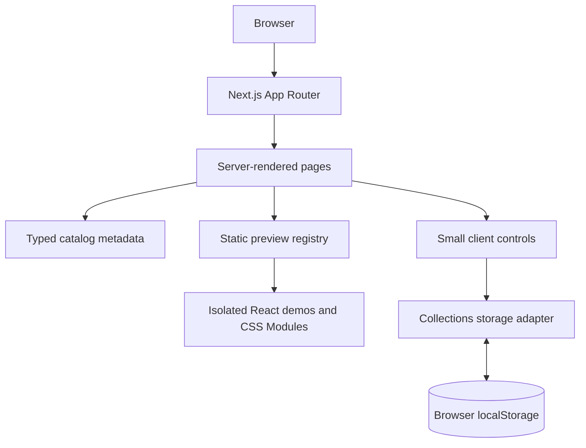

# UI Atlas architecture

UI Atlas keeps searchable metadata, executable React previews, routes, and browser-local state in separate places. The application has no backend or remote catalog.

## Request and data flow

## Main folders

| Location | Responsibility |
| --- | --- |
| `src/app/` | App Router pages, route metadata, and global CSS setup. |
| `src/components/layout/` | Shared header, main landmark, skip link, and footer. |
| `src/components/ui/` | Genuinely shared UI primitives (e.g. Button). |
| `src/features/catalog/components/` | Catalog-specific components (entry cards and save trigger). |
| `src/features/catalog/data/` | Searchable `CatalogItem` records and category definitions. |
| `src/features/catalog/lib/` | Lookup, category selection, and search helpers. |
| `src/features/collections/` | Client view, action hooks, and safe localStorage adapter for saved IDs. |
| `src/registry/manifest.ts` | Explicit static preview registration and lookup. |
| `src/registry/examples/` | Preview components and their colocated CSS Modules. |
| `src/lib/` | Reusable cross-feature utilities (e.g., `cn`). |
| `docs/` | Product, architecture, design, development, and research records. |

## App Router

- `/` composes category links and selected entry cards from the local catalog.
- `/library` reads the `q` search parameter. Because the project enables Next.js Cache Components, query-dependent results are awaited inside a React `Suspense` boundary.
- `/library/[category]` uses a generated list of known categories and calls `notFound()` for unknown slugs.
- Motion and animation examples use the same category and item routes as other components; the legacy `/animations` URL redirects to `/library/animations`.
- `/item/[slug]` uses generated static params for catalog entries and calls `notFound()` for unknown entries. It renders the registered preview, read-only TSX/CSS source with copy actions, a metadata-generated AI build prompt, and reuse attribution.
- `/collections` passes serializable catalog metadata into a small client component that reads saved IDs after hydration.
- `/about`, `/licenses`, and `/changelog` are static informational Server Component pages; license counts are derived from the catalog, while the dated changelog is maintained as project content.
- Pages are Server Components by default. Client Components are limited to localStorage-backed controls.

The installed Next.js 16.4.1 route props use promises for `params` and `searchParams`. Consult the matching local docs before changing these conventions.

## Catalog and preview registry

`CatalogItem` is a data-only model. It records stable identity, descriptive text, category, tags, visual style, intended use, preview key, source and attribution, reuse terms, packages, fonts/assets, responsive behavior, interaction behavior, and implementation notes.

The catalog stores a `previewKey`, not executable code or an import path. `src/registry/manifest.ts` statically imports each React demo and maps its key to a preview component and category. When adding an entry, keep the metadata key and registry entry consistent. Do not use `eval`, `Function`, arbitrary module paths, or catalog strings as code.

Client-side preview surfaces use `src/registry/client-previews.tsx`, a typed map of explicit `next/dynamic` imports. Its keys are checked against the static registry at compile time. This keeps Home, Library cards, and Background Studio from eagerly adding every demo to their client bundle; the static manifest remains the server-side source for detail previews and source validation.

`src/registry/lib/source.ts` resolves source files for the read-only item-page viewer. `src/features/catalog/lib/build-ai-prompt.ts` turns a `CatalogItem` into a copyable implementation prompt; keep it data-driven so each prompt explains the specific component and includes its usage, visual direction, interactions, responsive behavior, dependencies, assets, attribution, and reuse terms. The viewer may copy source or prompt text, but does not edit component source or expose a configurator.

## Preview isolation

Each demo lives below `src/registry/examples/<category>/` with a colocated `.module.css` file. Demo CSS cannot target the page shell or other previews through global class names. Keep demo dependencies in the corresponding catalog metadata. Use original art unless a source and licence have been checked.

## Styling

- `src/app/globals.css` owns Tailwind v4 import/theme mapping, shared design tokens, a small reset, base text and document defaults, focus and selection, and reduced-motion foundations.
- App pages and components use locally scoped CSS Modules. Preview modules remain beside their demo implementation.
- The shadcn/ui Base UI preset and generated source files remain available, but this milestone's visible controls use small custom components styled for the Atlas visual system. Its unused utility stylesheet is not imported into the app bundle.
- Keep CSS imports rooted in the App Router layout and verify production CSS order with `next build`.

## Browser-local saves

The collections storage adapter owns the versioned key `ui-atlas:saved-entry-ids:v1`. It catches malformed JSON and unavailable storage. `useSyncExternalStore` provides a stable empty server snapshot and a string snapshot of browser storage; local writes notify subscribers, and the browser `storage` event supports other tabs. The client collection joins saved IDs against the current catalog, so stale IDs are not rendered.

Do not read localStorage during Server Component rendering. A future database adapter can replace this boundary without changing catalog metadata or route presentation.

## Invalid data, assets, and licences

- Unknown route slugs use Next.js `notFound()`.
- A missing registry preview is shown as an unavailable-preview message rather than executing a metadata path.
- Source URL is `null` for original studies. Attribution and reuse fields still state that the study is first-party.
- Add external references only after checking the source and licence. Never invent an origin or mark unverified terms as verified.
- Fonts are loaded through `next/font/local` from the Latin WOFF2 files in `src/app/fonts/`, then served as generated assets with the application. Their OFL license texts live in `docs/licenses/`.

## Performance and future integration

The catalog is small and local; entries and previews are statically imported. Keep interaction code to the save controls, and avoid loading a general client-side preview engine for every card. For future third-party examples, prefer static local components with isolated CSS and declared dependencies. A later backend can provide catalog records and user saves behind these existing boundaries without introducing it in the current milestone.
